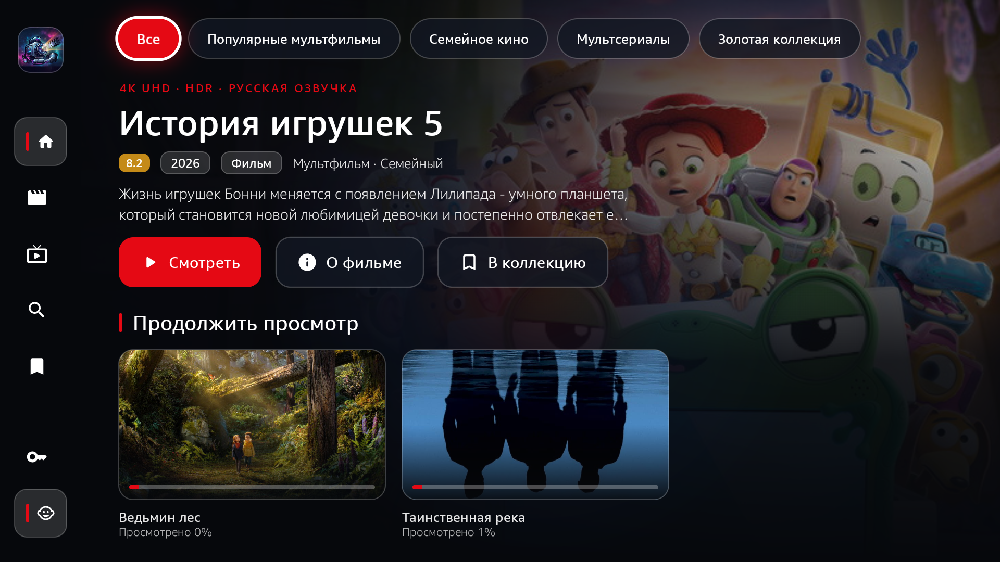
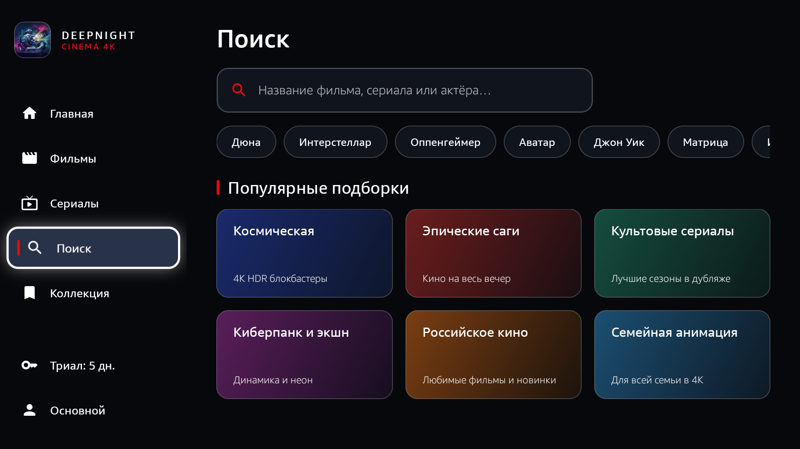
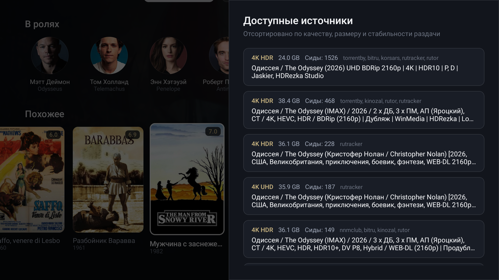
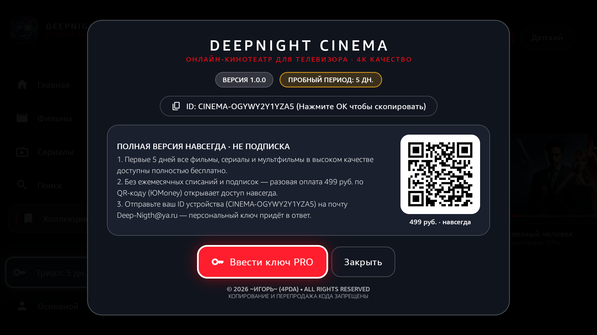

  

<h1 align="center">🎬 DEEPNIGHT CINEMA v1.0.0</h1>

<b>Самодостаточный онлайн-кинотеатр для Android TV и ТВ-приставок</b>

  
  
  
  
  

> **Автор идеи и концепта**: **`~ИГОРЬ~ (4PDA)`**  
> **Экосистема**: **DeepNight Ecosystem** (*DeepNight Launcher • DeepNight TV • DeepNight DSP • DeepNight Cinema*)  
> **Официальный профиль GitHub**: [Igor1974](https://github.com/Igor1974)  
> **Официальные релизы**: [Скачать сборки (Releases)](https://github.com/Igor1974/DeepNight-Cinema/releases)

---

---

## 🌟 О программе

**DeepNight Cinema** — ваш личный самодостаточный онлайн-кинотеатр для телевизора и Android TV приставок. Смотрите фильмы, сериалы и мультфильмы на большом экране в высоком качестве — **без рекламы, без ежемесячных подписок и без сложной настройки**.

### ⚡ 100% Самодостаточность («Поставил и смотришь»)
В отличие от классических ТВ-каталогов, **DeepNight Cinema** не требует установки и настройки сторонних программ:
- ❌ **Не нужен TorrServe** — движок потоковой загрузки уже встроен прямо в приложение.
- ❌ **Не нужны Jackett, парсеры и плагины** — умный поиск источников и подбор лучшего варианта с русской озвучкой работают «из коробки».
- ❌ **Не нужен сторонний видеоплеер** — встроенный аппаратный плеер на базе Media3 заточен под обычный ТВ-пульт.

Достаточно установить один APK, взять пульт и нажать **«Смотреть»**.

---

## 📸 Скриншоты интерфейса

| Топ-10 сейчас в 4K и Новинки в цифре | Раздел «Сериалы» |
| :---: | :---: |
|  |  |

| Детский режим | Поиск и популярные подборки |
| :---: | :---: |
|  |  |

| Выбор источников 4K HDR и «В ролях» | Лицензия и активация PRO |
| :---: | :---: |
|  |  |

---

## ✨ Ключевые возможности

- **🎞 Огромный каталог фильмов и сериалов** — новинки, популярное кино, «Топ-10 сейчас», подборки по жанрам и бесконечные ленты рекомендаций с автоматическим обновлением.
- **🚀 Запуск в один клик (Zero-Setup)** — приложение само выбирает оптимальный вариант видео с русской озвучкой. Прямо во время просмотра можно сменить качество, аудиодорожку или включить субтитры.
- **📺 Плеер под обычный ТВ-пульт** — панель управления открывается любой кнопкой, плавная перемотка с ускорением, отображение времени окончания фильма, изменение масштаба экрана (удаление чёрных полос), выбор скорости и автопереход к следующей серии.
- **🌈 Атмосфера кинозала (Living Ambilight)** — мягкая адаптивная фоновая подсветка краёв экрана подстраивается под палитру фильма (с безопасным режимом для 10-bit/HDR потоков на Realtek ТВ).
- **🔖 «Продолжить просмотр» и «Избранное»** — точное запоминание минуты и серии, на которой вы остановились, плюс быстрый доступ к любимым фильмам.
- **🧸 Отдельный Детский режим** — в одно нажатие переключает каталог на мультфильмы и безопасное семейное кино.
- **🔎 Удобный поиск и персоны** — поиск по названию, фильмография любимых актёров/режиссёров и подборки похожих картин.
- **🌌 Фирменный дизайн DeepNight Ecosystem** — глубокая тёмная палитра Deep Space Dark (`#0A0D14`), созданная специально для больших экранов и комфортного просмотра в темноте.

---

## 📱 Системные требования

| Параметр | Значение |
| :--- | :--- |
| **Платформа** | Android TV / Google TV / Android-приставки |
| **Минимальная ОС** | Android 8.0+ (API 26) |
| **Архитектуры** | Universal APK (`arm64-v8a`, `armeabi-v7a`, `x86`, `x86_64`) |
| **Package ID** | `com.deepnight.cinema` |
| **Текущая версия** | `v1.0.0` |

---

## 🎁 Условия использования и активация PRO

- **🆓 5 дней полного доступа бесплатно** — попробуйте все возможности без ограничений и привязки банковских карт.
- **👑 Единоразовая покупка навсегда (499 ₽)** — один платёж без подписок, автосписаний и скрытых условий.

### 💳 Как активировать PRO-лицензию:
1. Отсканируйте QR-код в окне активации приложения или перейдите на страницу оплаты **[ЮMoney (499 руб.)](https://yoomoney.ru/to/41001983944189)**.
2. Отправьте ваш **ID устройства** (отображается в окне активации приложения) на email: **Deep-Nigth@ya.ru**.
3. Введите полученный ключ активации в приложении — доступ откроется навсегда.

---

## 📥 Скачать

Готовый подписанный APK доступен в разделе **[Releases](https://github.com/Igor1974/DeepNight-Cinema/releases)**:
- 📺 **[DeepNight_Cinema_v1.0.0.apk](https://github.com/Igor1974/DeepNight-Cinema/releases/download/v1.0.0/DeepNight_Cinema_v1.0.0.apk)** — универсальная сборка для всех Android TV и приставок.

> ℹ️ *Данный репозиторий предназначен исключительно для публикации официальных релизных сборок (APK) и документации. Исходный код проекта закрыт.*

---

## 🔗 Другие проекты DeepNight Ecosystem
- 🏠 **[DeepNight Launcher (Custom-Launcher-ROOT)](https://github.com/Igor1974/Custom-Launcher-ROOT-)** — сверхбыстрый лаунчер для Android TV.
- 🎵 **[DeepNight DSP](https://github.com/Igor1974/DeepNight-DSP)** — 15-полосный студийный аудиопроцессор и эквалайзер для Android TV, Linux и Windows.

---

© 2026 **~ИГОРЬ~ (4PDA)** • **DeepNight Ecosystem** • ALL RIGHTS RESERVED.  
*Копирование, перепродажа и декомпиляция кода запрещены.*
